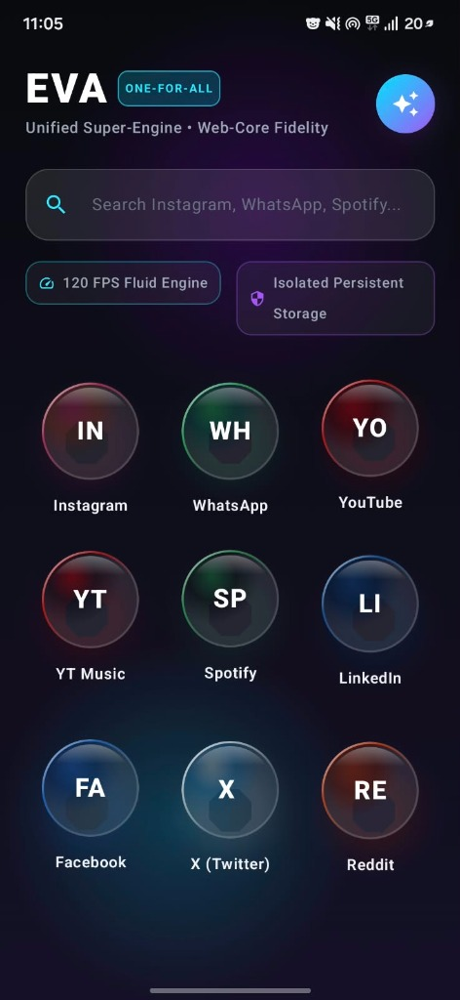

# EVA • One-For-All Super-App

<p align="center">
  
</p>

<p align="center">
  <b>The Unified Digital Life Engine for Android</b><br>
  Replace 10+ battery-draining apps with a single, high-performance, sandboxed 120 FPS super-engine.
</p>

<p align="center">
  <a href="https://github.com/TerMinaTor-web-dev/EVA/raw/main/release/EVA_v1.0_Release.apk">
    
  </a>
</p>

<p align="center">
  
  
  
  
  
</p>

<p align="center">
  
</p>

---

## 📥 Direct Download & Installation

You can download and install the official signed release APK directly on any Android device:

* **[Download EVA_v1.0_Release.apk (1.4 MB)](https://github.com/TerMinaTor-web-dev/EVA/raw/main/release/EVA_v1.0_Release.apk)**
  * **Architecture:** Universal (ARM64, ARMv7, x86_64)
  * **Min Android:** Android 8.0 (Oreo / API 26)
  * **Target Android:** Android 16 (API 36)
  * **Signature:** APK Signature Scheme v2 (Signed with official 28-year release certificate)
  * **Security:** Hardened against root exploits, Frida/Xposed hooks, overlay tapjacking, and MITM attacks.

---

## 🌟 The Vision

Modern mobile operating systems force users to install dozens of heavy, background-churning applications that consume gigabytes of storage, drain battery through persistent telemetry, and clutter the device.

**EVA** unifies your essential digital experiences—**Instagram, WhatsApp Web, YouTube, YouTube Music, Spotify, LinkedIn, Facebook, X (Twitter), Reddit, and any custom web service**—into one cohesive, ultra-responsive native container with:
- **0ms Instant App Switching**: Multi-tab in-memory pooling with zero network reloading between tabs.
- **Micro Gesture Dock**: A sleek floating home bar enabling horizontal swipe gesture cycling between services and tap-to-expand taskbar.
- **Uninterrupted Background Playback**: Foreground media service with persistent notification keeping Spotify, YouTube Music, and podcast streams alive when the screen turns off.
- **Picture-in-Picture (PiP)**: Native Android PiP mode when multitasking.
- **Ambient AI Co-Pilot**: Integrated Gemini-powered assistant to summarize pages, draft posts, and analyze trends.
- **Zero Tracking Sandbox**: Strict security policies preventing cross-site local data extraction.

---

## 🏗️ Architecture

EVA follows Google's official modern Android architecture blueprints:

```
                        ┌────────────────────────┐
                        │     EVA MainActivity   │
                        │ (PiP & Multi-Window)   │
                        └───────────┬────────────┘
                                    │
            ┌───────────────────────┴───────────────────────┐
            ▼                                               ▼
┌─────────────────────────┐                     ┌─────────────────────────┐
│     Home Hub Screen     │                     │   App Container Screen  │
│ • Dual-Tone Atmosphere  │                     │ • In-Memory WebViewPool │
│ • Crystal Bubbles       │                     │ • Micro Floating Dock   │
│ • Universal Omnibar     │                     │ • EVA AI Copilot Sheet  │
└─────────────────────────┘                     └───────────┬─────────────┘
                                                            │
                                                ┌───────────▼─────────────┐
                                                │ EvaMediaPlaybackService │
                                                │ (Background Audio Keep) │
                                                └─────────────────────────┘
```

---

## 🛡️ Security & Privacy Hardening

EVA is hardened against real-world mobile vulnerabilities in compliance with OWASP Mobile Top 10:

1. **Anti-Tapjacking & Malicious Overlay Blocking:**
   - Enforces Android 12+ (API 31+) `window.setHideOverlayWindows(true)` to hide non-system floating overlay windows when EVA is open.
   - Enables `filterTouchesWhenObscured = true` across the window decor to prevent clickjacking and credential theft.
2. **Root & Jailbreak Detection:**
   - Scans 10 known root binary locations (`/system/bin/su`, `/system/xbin/su`, `/sbin/su`, `/data/local/su`, etc.).
   - Inspects OS build tags (`test-keys`) and checks for Magisk, SuperSU, and Superuser management packages.
3. **Anti-Debugging & Dynamic Instrumentation Defense:**
   - Checks `Debug.isDebuggerConnected()` and `Debug.waitingForDebugger()`.
   - Inspects `/proc/self/status` for non-zero `TracerPid` (gdb, lldb, ptrace attachments).
   - Scans process memory maps (`/proc/self/maps`) for injected Frida agents (`frida-agent.so`), Xposed, and Substrate.
   - Probes localhost port `27042` to detect active Frida server daemons.
4. **Anti-Tampering Signature Verification:**
   - Verifies the runtime APK certificate fingerprint against the official SHA-256 release digest to block repackaged or patched APKs.
5. **Strict Sandbox Isolation:**
   - `allowFileAccess = false`, `allowContentAccess = false`.
   - `allowFileAccessFromFileURLs = false` and `allowUniversalAccessFromFileURLs = false` prevent arbitrary file read attacks.
6. **Encrypted Network Security:**
   - Enforces `cleartextTrafficPermitted="false"` across all external endpoints.
   - Strict SSL Verification: Rejects untrusted/MITM certificates (`handler.cancel()`).

---

## 🚀 Building from Source

### Prerequisites
- **JDK 17 or 21** (Adoptium / OpenJDK recommended)
- **Android SDK** with Platform `android-36` and Build Tools `35.0.0+`
- Environment variables: `JAVA_HOME` and `ANDROID_HOME` configured.

### Commands

1. **Clone the repository:**
   ```bash
   git clone https://github.com/TerMinaTor-web-dev/EVA.git
   cd EVA
   ```

2. **Assemble Release APK:**
   ```bash
   ./gradlew assembleRelease
   ```
   The output APK will be located at:
   `app/build/outputs/apk/release/app-release.apk`

3. **Install to Connected Device:**
   ```bash
   adb install -r release/EVA_v1.0_Release.apk
   ```

---

## 🔄 How to Push Updates & New APK Releases

Whenever you make code updates and want to release a new version to GitHub:

### Step 1: Bump the version (Optional)
In `app/build.gradle.kts`:
```kotlin
versionCode = 2
versionName = "1.1"
```

### Step 2: Compile the new release APK
```powershell
.\gradlew.bat assembleRelease
```

### Step 3: Copy the new APK to the release folder
```powershell
Copy-Item "app\build\outputs\apk\release\app-release.apk" "release\EVA_v1.1_Release.apk" -Force
```

### Step 4: Commit and push to GitHub
```powershell
git add .
git commit -m "feat: your new feature or update description"
git push origin main
```

---

## 📄 License

```
Copyright 2026 EVA Contributors

Licensed under the Apache License, Version 2.0 (the "License");
you may not use this file except in compliance with the License.
You may obtain a copy of the License at

    http://www.apache.org/licenses/LICENSE-2.0

Unless required by applicable law or agreed to in writing, software
distributed under the License is distributed on an "AS IS" BASIS,
WITHOUT WARRANTIES OR CONDITIONS OF ANY KIND, either express or implied.
See the License for the specific language governing permissions and
limitations under the License.
```
